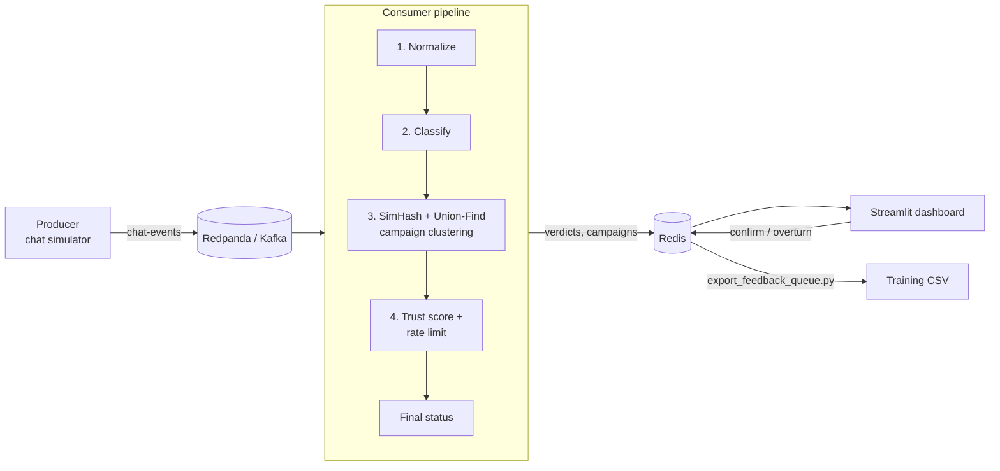

# Hinglish Moderation Platform

A real-time content moderation pipeline for **Hinglish** (Hindi–English code-mixed) chat. It classifies each message, tracks per-user trust and posting velocity, and detects coordinated spam or abuse campaigns using **SimHash fingerprints and Union-Find clustering**, with a live Streamlit dashboard and a moderator feedback loop for continuous improvement.

> **Project status:** The streaming pipeline, campaign detection, trust scoring, dashboard and evaluation tooling are complete and runnable on synthetic data. The default classifier is a **rule-based placeholder**, not a trained model. A fine-tuning path for HingBERT / HingRoBERTa is included, but no trained weights or real datasets ship with this repository. See [Current Status](#current-status) and [Limitations](#limitations).

---

## Table of Contents

- [Features](#features)
- [Architecture](#architecture)
- [Tech Stack](#tech-stack)
- [Quick Start](#quick-start)
- [Project Structure](#project-structure)
- [How It Works](#how-it-works)
- [Configuration](#configuration)
- [Tooling and Evaluation](#tooling-and-evaluation)
- [Training a Real Model](#training-a-real-model)
- [Moderator Feedback Loop](#moderator-feedback-loop)
- [Testing](#testing)
- [Current Status](#current-status)
- [Limitations](#limitations)
- [Roadmap](#roadmap)
- [Contributing](#contributing)

---

## Features

- **Streaming pipeline:** Kafka-compatible ingestion (Redpanda) with a consumer that normalizes, classifies, clusters and scores every message.
- **Three-level verdicts:** `safe`, `abusive`, `severe`, mapped to the actions `published`, `flagged` and `held_for_review`.
- **Campaign detection:** Word-level 64-bit SimHash plus Union-Find groups near-duplicate messages across users and channels, and is robust to word reordering and changing URLs.
- **Trust and rate limiting:** Redis-backed per-user trust score (0.0–1.0) and a sliding-window velocity limiter that tightens for low-trust users.
- **Live dashboard:** Streamlit UI with a live feed, user trust table, campaign clusters and a moderator review panel.
- **Active-learning loop:** Moderators confirm or overturn verdicts, and the decisions export as training-ready CSV rows.
- **Empirical tuning tools:** Scripts to calibrate the SimHash threshold and velocity limits instead of guessing.
- **Adversarial test suite:** 24 hand-written Hinglish edge cases (negation, sarcasm, reclaimed slang, obfuscation, mixed scripts) with a per-category report.
- **Model tooling:** Data preparation and quality report, model bake-off (HingBERT vs HingRoBERTa vs MuRIL), fine-tuning, evaluation, ONNX export and a latency benchmark.

---

## Architecture


**Message statuses**

| Condition | Status |
|---|---|
| Label is `severe` | `held_for_review` |
| Label is `abusive`, or the user exceeded their velocity limit | `flagged` |
| Otherwise | `published` |

---

## Tech Stack

| Layer | Technology |
|---|---|
| Messaging | Redpanda (Kafka API), `kafka-python` |
| State and storage | Redis 7 |
| Campaign detection | `simhash`, custom Union-Find |
| Dashboard | Streamlit, pandas |
| Modeling | Hugging Face `transformers`, PyTorch, `datasets`, scikit-learn |
| Optional deployment | ONNX / `optimum` |
| Infrastructure | Docker Compose |

---

## Quick Start

### Prerequisites

- Python 3.10+
- Docker and Docker Compose

### 1. Start infrastructure

```bash
docker compose up -d        # or: make up
```

This starts Redpanda (port `9092`), the Redpanda Console (`8080`) and Redis (host port **`6380`**).

### 2. Install dependencies

```bash
python -m venv venv
source venv/bin/activate    # Windows: venv\Scripts\activate
pip install -r requirements.txt
```

> `requirements.txt` includes `torch` and `transformers`, which are large. They are only needed once you use a real model; the placeholder classifier does not require them.

### 3. Verify the pipeline (Kafka not required)

```bash
python scripts/smoke_test.py    # or: make smoke-test
```

This runs the full classify → cluster → trust flow directly against the sample data and needs only Redis. **Note:** it flushes the Redis database it connects to.

### 4. Run the full stack

Use three terminals:

```bash
python consumer/consumer.py              # Terminal A: pipeline
python producer/producer.py --loop       # Terminal B: replays sample data
streamlit run dashboard/app.py           # Terminal C: dashboard
```

Open the dashboard at <http://localhost:8501>. The dashboard does not poll automatically, so use the **Refresh** button to see new messages.

Producer options: `--source`, `--bootstrap-servers`, `--min-delay`, `--max-delay`, `--loop`.

---

## Project Structure

```
hinglish-mod-platform/
├── docker-compose.yml           # Redpanda, Redpanda Console, Redis
├── Makefile                     # Convenience targets
├── requirements.txt
├── producer/
│   └── producer.py              # Simulated chat stream → Kafka
├── consumer/
│   ├── consumer.py              # Main pipeline loop
│   ├── classifier.py            # RuleBasedClassifier (placeholder) + HingBertClassifier
│   ├── simhash_cluster.py       # SimHash + Union-Find campaign detection
│   ├── trust.py                 # Redis trust score + sliding-window rate limiter
│   └── feedback.py              # Moderator confirm/overturn store
├── dashboard/
│   └── app.py                   # Streamlit dashboard + review panel
├── scripts/
│   ├── prepare_data.py          # Cleaning, quality report, stratified split
│   ├── model_bakeoff.py         # HingBERT vs HingRoBERTa vs MuRIL
│   ├── train.py                 # Hugging Face Trainer fine-tuning
│   ├── evaluate.py              # Macro-F1 + HateCheckHIn evaluation
│   ├── run_tricky_tests.py      # Adversarial test runner
│   ├── tune_simhash_threshold.py
│   ├── tune_rate_limits.py
│   ├── smoke_test.py            # Kafka-free end-to-end check
│   ├── export_feedback_queue.py # Moderator feedback → training CSV
│   ├── latency_benchmark.py     # p50/p95/p99 latency, throughput
│   └── export_onnx.py           # ONNX export + output verification
├── data/
│   ├── sample/sample_messages.jsonl   # 25 synthetic messages
│   └── tricky_test_messages.md        # Adversarial test set (24 cases)
├── models/                      # Fine-tuned checkpoints (git-ignored)
└── tests/
```

---

## How It Works

### 1. Classification

`consumer/classifier.py` exposes a single interface, `predict(text) -> {"label", "confidence"}`, with two implementations:

- **`RuleBasedClassifier`** (default): keyword lexicon placeholder. It exists so the pipeline runs end to end without a model. It is **not** suitable for real moderation (see [Limitations](#limitations)).
- **`HingBertClassifier`**: loads a fine-tuned Hugging Face sequence-classification checkpoint. Label order is `0=safe, 1=abusive, 2=severe`.

To switch, change `get_classifier()` at the bottom of `consumer/classifier.py`:

```python
def get_classifier():
    return HingBertClassifier(model_path="models/hingroberta-finetuned")
```

### 2. Campaign detection

1. Text is normalized for fingerprinting (lowercased, URLs, digits and punctuation removed; Roman script only).
2. A word-level 64-bit **SimHash** is computed. Word features keep reordered spam variants close together.
3. The new fingerprint is compared with fingerprints from the last 10 minutes; pairs within a **Hamming distance of 15** are unioned.
4. Clusters of **3 or more** messages are reported as campaigns (`C-xxxxxxxx`) with message, user and channel counts.

On the bundled synthetic data, near-duplicate spam lands 0–13 bits apart and unrelated messages 18+ bits apart. This is a small synthetic set, so re-tune on real data (see [Tooling](#tooling-and-evaluation)).

### 3. Trust and rate limiting

| Event | Trust change |
|---|---|
| `safe` message | +0.02 |
| `abusive` message | −0.08 |
| `severe` message | −0.25 |
| Rate-limit trip | −0.15 additional |

New users start at `0.5`. Messages per 60 seconds above **20** trip the limiter, or above **8** if trust is below `0.3`. State is stored in Redis (`user:{id}:trust`, `user:{id}:velocity`).

### Redis keys

| Key | Type | Purpose |
|---|---|---|
| `moderation:recent_verdicts` | list (capped at 500) | Latest verdict records for the dashboard |
| `moderation:campaigns` | hash | Campaign summaries |
| `moderation:feedback` | hash | Moderator decisions |
| `user:{id}:trust` | string | Trust score |
| `user:{id}:velocity` | sorted set | Message timestamps in the window |

---

## Configuration

Values are currently set as constants or CLI flags.

| Setting | Location | Default |
|---|---|---|
| Kafka bootstrap servers | `--bootstrap-servers` (consumer, producer) | `localhost:9092` |
| Redis host / port | `--redis-host`, `--redis-port` (consumer) | `localhost` / `6380` |
| Kafka topic | `TOPIC` in producer and consumer | `chat-events` |
| Hamming threshold | `HAMMING_THRESHOLD` in `simhash_cluster.py` | `15` |
| Min campaign size | `MIN_CLUSTER_SIZE` | `3` |
| Fingerprint window | `RECENT_WINDOW_SECONDS` | `600` |
| Velocity limits | `DEFAULT_VELOCITY_LIMIT` / `TIGHTENED_VELOCITY_LIMIT` in `trust.py` | `20` / `8` per 60 s |

> The dashboard, smoke test and feedback export scripts hard-code Redis at `localhost:6380`.

---

## Tooling and Evaluation

| Command | Purpose |
|---|---|
| `make tune-threshold` | Sweep Hamming thresholds; report recall vs. false merges |
| `make tune-rate-limits` | Simulate user behavior patterns against candidate velocity limits |
| `make tricky-tests` | Run the adversarial set; per-category accuracy and mismatches |
| `make latency-bench` | p50/p95/p99 latency and throughput of the classifier |
| `make smoke-test` | Kafka-free end-to-end check (needs Redis) |

### Baseline: placeholder classifier on the adversarial set

| Category | Accuracy |
|---|---|
| Control, sarcasm, threats | 100% |
| Script mixing | 50% |
| Targeted abuse, reclaimed slang | 33% |
| Obfuscation | 25% |
| Negation, borderline profanity | 0% |
| **Overall** | **10 / 24 (42%)** |

This baseline is intentional: pure keyword matching cannot handle negation, context or obfuscation. It sets the bar a fine-tuned model must clear. Sarcasm scores 100% only because the sarcastic examples contain no lexicon terms, so it reflects no real understanding.

---

## Training a Real Model

Datasets and weights are not included. You need to obtain them yourself:

| Resource | Notes |
|---|---|
| [HingBERT / HingRoBERTa](https://huggingface.co/l3cube-pune) (L3Cube) | Downloaded automatically by `transformers` |
| Bohra et al. (2018) Hinglish hate speech | Tweet IDs only; must be hydrated |
| PRISM, HateCheckHIn | Optional augmentation and diagnostic suite |

Check each dataset's license and terms before use.

```bash
# 1. Clean data and print a quality report; writes train.csv / test.csv
python scripts/prepare_data.py --raw_csv data/bohra/raw_hydrated.csv \
    --text_col tweet_text --label_col hate_label \
    --label_map "none:0,offensive:1,hateful:2" --output_dir data/bohra

# 2. Compare candidate models (GPU recommended)
python scripts/model_bakeoff.py --data_dir data/bohra --mode finetune --epochs 2 --sample_size 2000

# 3. Fine-tune
python scripts/train.py --data_dir data/bohra \
    --model_name l3cube-pune/hing-roberta --output_dir models/hingroberta-finetuned

# 4. Evaluate (macro-F1, optional HateCheckHIn breakdown)
python scripts/evaluate.py --model_path models/hingroberta-finetuned --test_csv data/bohra/test.csv

# 5. Optional: export to ONNX and benchmark
pip install "optimum[onnxruntime]" onnx onnxruntime
python scripts/export_onnx.py --model_path models/hingroberta-finetuned --output_path models/hingroberta-onnx
python scripts/latency_benchmark.py --mode onnx --model_path models/hingroberta-onnx
```

Training data must be a CSV with `text` and integer `label` columns (`0=safe`, `1=abusive`, `2=severe`). Fine-tuning requires a GPU, and Colab or Kaggle free tiers are sufficient for the bake-off.

---

## Moderator Feedback Loop

1. Open the **Moderator review** panel in the dashboard.
2. For each flagged or held message, click **Confirm** or choose a corrected label and click **Overturn**.
3. Export decisions as training rows:

```bash
python scripts/export_feedback_queue.py --output data/bohra/feedback_batch_1.csv
```

The export warns when the overturn rate exceeds 30%, which usually points to a systematic classifier weakness rather than a data shortage.

---

## Testing

```bash
make test        # pytest; needs Redis on localhost:6380
```

- `tests/test_simhash_cluster.py`: Union-Find, near-duplicate clustering, cross-channel campaigns (no external services).
- `tests/test_feedback.py`: feedback store logic (requires Redis; **it flushes the database**, so do not point it at a Redis instance holding data you want to keep).

---

## Current Status

| Component | Status |
|---|---|
| Docker Compose (Redpanda, Redis) | Done |
| Producer and consumer pipeline | Done |
| SimHash + Union-Find campaign detection | Done, tuned on synthetic data |
| Trust score and rate limiting | Done, tuned on simulated patterns |
| Streamlit dashboard and review panel | Done |
| Feedback export, tuning and benchmark scripts | Done |
| Fine-tuned Hinglish model | **Not included** (placeholder in use) |
| Real datasets, trained checkpoints | **Not included** |
| Load testing at production scale | Not performed |

## Limitations

- **The default classifier is not a real moderation model.** It matches a small keyword list, so it flags benign uses (`"yeh bilkul bakwas nahi hai"`), misses obfuscated terms (`ch*tiya`, `b3wakoof`) and ignores Devanagari. Do not use it to make moderation decisions on real users.
- **Campaign detection does not yet change a message's status.** Detected campaigns appear in the dashboard, but messages in a campaign are still `published` unless another rule flags them. The first messages of a campaign are also published before the cluster reaches the minimum size.
- **Detector state is in memory.** Campaign state is lost on consumer restart, grows without bound (only fingerprints are pruned), and the comparison is a linear scan. It is not suitable for high-throughput use without an LSH index and Redis-backed storage.
- **Roman-script only fingerprinting.** Devanagari text is ignored by the SimHash normalizer.
- **Thresholds are tuned on tiny synthetic sets** (25 messages, 6-message spam block). Re-tune on real data before relying on them.
- **Single consumer, no authentication** on the dashboard or Redis. This is a development setup, not a hardened deployment.

## Roadmap

- [ ] Fine-tune and evaluate HingRoBERTa on real data; publish macro-F1 and HateCheckHIn results
- [ ] Feed campaign membership into the final moderation decision
- [ ] Redis-backed fingerprint store with an LSH index
- [ ] Devanagari and transliteration normalization (leetspeak, symbol obfuscation)
- [ ] Token-level explainability for flagged messages
- [ ] Discord / Telegram integration
- [ ] Marathi extension
- [ ] Environment-variable configuration and CI

## Contributing

Issues and pull requests are welcome. Please run `make test` and `make tricky-tests` before submitting changes, and include before/after numbers for anything that affects classification or clustering.

## License

No license has been specified yet. Add a `LICENSE` file (for example MIT or Apache-2.0) before publishing so others know how they may use the code.

## Acknowledgements

- [L3Cube](https://github.com/l3cube-pune) for HingBERT and HingRoBERTa
- Bohra et al. (2018) for the Hindi-English code-mixed hate speech dataset
- HateCheckHIn and PRISM dataset authors
